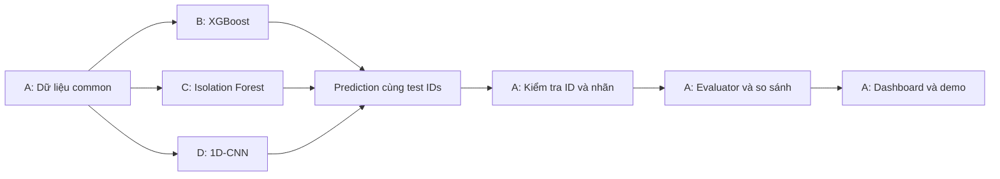

<div align="center">

# 🛡️ DoH Tunneling Detection

**Phát hiện DNS tunneling trong lưu lượng DNS-over-HTTPS mã hóa**

`XGBoost` · `Isolation Forest` · `1D-CNN` · `CIRA-CIC-DoHBrw-2020`

[🚀 Bắt đầu](#bắt-đầu-từ-đâu) · [📂 Cấu trúc project](#cấu-trúc-project) · [📖 Hướng dẫn dữ liệu](docs/TRAINING_GUIDE.md) · [🛠️ Công việc](TODO.md)

</div>

---

## Giới thiệu đề tài

DNS-over-HTTPS (DoH) truyền các truy vấn DNS qua HTTPS, bảo vệ nội dung truy vấn trong kết nối mã hóa. DNS tunneling lợi dụng cơ chế trao đổi DNS để mang dữ liệu hoặc thông tin điều khiển; khi đi qua DoH, việc quan sát trực tiếp nội dung DNS từ lưu lượng mạng trở nên khó khăn hơn.

Đề tài nghiên cứu khả năng **phân biệt benign DoH và tunnel DoH bằng đặc trưng hành vi mạng, không giải mã payload**. Dữ liệu lấy từ CIRA-CIC-DoHBrw-2020, gồm lưu lượng browser Chrome/Firefox và các công cụ tunnel dns2tcp, dnscat2, iodine theo kịch bản nguồn.

| Nội dung | Phạm vi thực hiện |
|---|---|
| Bài toán | Phân loại nhị phân: `0 = benign DoH`, `1 = malicious/tunnel DoH` |
| Dữ liệu quan sát | Thống kê flow và chuỗi độ dài, hướng truyền, thời gian giữa packet |
| Phương pháp | Học có giám sát, phát hiện bất thường từ benign và học chuỗi bằng CNN |
| Sản phẩm | Ba baseline, evaluator chung và dashboard so sánh kết quả |
| Phạm vi | Phân tích offline trên dataset; chưa triển khai IDS thời gian thực |

### Cơ sở lý thuyết

**Flow và packet sequence.** Flow gom các packet thuộc một luồng giao tiếp để tính các thống kê như duration, lượng byte và phân bố thời gian/kích thước. Packet sequence giữ thứ tự các gói để mô hình học biến thiên theo thời gian. Dù payload được mã hóa, độ dài, thời điểm và hướng truyền vẫn cung cấp dấu hiệu có thể dùng để phân loại.

| Mô hình | Nguyên lý | Đầu vào trong dự án | Điểm cần khảo sát |
|---|---|---|---|
| **XGBoost** | Kết hợp nhiều cây quyết định theo boosting, các cây sau cải thiện hàm mục tiêu của tổ hợp | 29 thống kê flow; train có cả hai nhãn | Hiệu quả phân loại trên đặc trưng dạng bảng |
| **Isolation Forest** | Cô lập mẫu bằng các phép chia ngẫu nhiên; mẫu bất thường thường có đường đi cô lập ngắn hơn | 29 thống kê đã scale; chỉ fit benign train | Khả năng phát hiện tunnel từ mô hình học lưu lượng bình thường và mức cảnh báo sai |
| **1D-CNN** | Tích chập một chiều học các mẫu cục bộ trên chuỗi packet | Tối đa 32 packet, 3 kênh length/direction/IAT, kèm mask | Khả năng khai thác cấu trúc và thứ tự packet |

Isolation Forest không dùng malicious để fit cây, nhưng **nhãn validation vẫn được dùng để chọn cấu hình/ngưỡng**. CNN cần mask để xử lý padding; chỉ lưu mask trong file chưa đủ để mô hình sử dụng nó.

### Câu hỏi thực nghiệm và điểm nhấn

- Ba phương pháp phát hiện được bao nhiêu tunnel và tạo ra bao nhiêu cảnh báo sai trên cùng tập flow đánh giá?
- Hiệu quả khác nhau thế nào giữa dns2tcp, dnscat2 và iodine; benign Chrome/Firefox có mức false positive ra sao?
- Mức phát hiện đạt được có tương xứng với thời gian inference và kích thước model không?

Điểm nhấn là **phát hiện từ hành vi của traffic mã hóa**, **so sánh ba cách tiếp cận trên cùng test IDs** và **đánh giá đồng thời Recall, FPR và chi phí tính toán**. XGBoost/IF dùng thống kê toàn flow, CNN dùng prefix 32 packet: kết quả so sánh cả phương pháp lẫn biểu diễn đầu vào, chưa tách riêng ảnh hưởng kiến trúc.

---

## Bắt đầu từ đâu?

1. Đọc [Hướng dẫn sử dụng dữ liệu huấn luyện](docs/TRAINING_GUIDE.md): nhận và giải nén `common.tar.gz`, chọn đúng dữ liệu, nạp đầu vào và xuất prediction.
2. Mở [Công việc triển khai](TODO.md) để xem phần code của mình.
3. Làm việc trên nhánh tương ứng theo [hướng dẫn branch](docs/branch_guide.md).

Pipeline dữ liệu đã có và common đã sẵn sàng để train. Các module mô hình, evaluator và dashboard hiện là khung cần triển khai. B/C/D có thể bắt đầu song song ngay sau khi nhận dữ liệu. B/C/D chỉ train và xuất model/thông tin theo [quy ước bàn giao](docs/TRAINING_GUIDE.md#41-mỗi-người-cần-lưu-gì-và-để-ở-đâu); A tổng hợp metric, biểu đồ, so sánh và dashboard.

## Thiết lập môi trường

Python 3.10+ và Git; khuyến nghị Linux/Ubuntu.

```bash
git clone https://github.com/doandangkhoa/DoH-tunneling-detection.git
cd DoH-tunneling-detection
python3 -m venv .venv
source .venv/bin/activate
python -m pip install -r requirements.txt
```

A gửi gói `common.tar.gz` qua kho chia sẻ của nhóm.

```bash
tar -xzf common.tar.gz
```

Dùng cùng gói dữ liệu cho cả ba mô hình. Không cần chạy lại xử lý PCAP. Mỗi thành viên triển khai CLI trong module phụ trách và bổ sung lệnh chạy vào tài liệu khi dùng được.

## Phân công và đầu vào

| Thành viên | Phần triển khai | Dữ liệu dùng khi so sánh chung | Nhánh |
|---|---|---|---|
| A | Dữ liệu, evaluator, so sánh và dashboard | `src/data/`, `src/evaluation/`, `scripts/`, `dashboard/` | `feature/data-pipeline` |
| B | Train XGBoost và xuất kết quả | `data/processed/xgboost/common/` | `feature/xgboost` |
| C | Train Isolation Forest và xuất kết quả | `data/processed/isolation_forest/common/` | `feature/isolation-forest` |
| D | Train 1D-CNN và xuất kết quả | `data/processed/cnn1d/` | `feature/cnn1d` |

Common có 168.597 flow train, 8.092 val và 13.411 test. IF train chỉ gồm 5.383 benign trong common train; val/test giống hai mô hình còn lại. Chi tiết shape, array keys, mask và code nạp dữ liệu nằm trong [training guide](docs/TRAINING_GUIDE.md#2-mỗi-thành-viên-dùng-bộ-nào).

## Luồng triển khai



Train dùng để học mô hình; validation để chọn cấu hình và threshold. Chỉ chạy đánh giá test cuối sau khi khóa mô hình/ngưỡng. Không tự chia lại dữ liệu hoặc fit preprocessing trên val/test.

Mỗi mô hình xuất `outputs/<model>/predictions.parquet` gồm `sample_id`, `model`, `y_true`, `y_score`, `y_pred`, `threshold`, `split`. Score càng cao càng nghi malicious; IF score không nhất thiết là xác suất. Ba file phải khớp toàn bộ ID và nhãn test. Tên file model, config, số liệu runtime và kết quả evaluator được thống nhất tại [bảng đầu ra của từng người](docs/TRAINING_GUIDE.md#41-mỗi-người-cần-lưu-gì-và-để-ở-đâu). Xem [chuẩn prediction và đánh giá](docs/TRAINING_GUIDE.md#4-xuất-kết-quả-để-so-sánh-chung).

## Các bước tiếp theo và sản phẩm cuối

Vòng triển khai đầu dùng **một cấu hình baseline, một seed cho mỗi mô hình**, CNN cố định 32 packet. Cả nhóm dùng common 190.100 flow, seed 42; chưa cần train thêm bộ full. Xem [phạm vi huấn luyện đã thống nhất](docs/TRAINING_GUIDE.md#phạm-vi-huấn-luyện-đã-thống-nhất). Mục tiêu là có luồng chạy hoàn chỉnh với kết quả thực và giải thích được; chưa cần tìm kiếm tham số lớn.

| Bước | Phụ trách | Việc làm | Sản phẩm |
|---|---|---|---|
| 1. Train baseline | B/C/D | Nạp common, train theo YAML, chọn threshold bằng validation | Model/checkpoint, config, validation score, threshold đã khóa |
| 2. Predict test | B/C/D; A nhận kết quả | Sau khi khóa model/ngưỡng, xuất prediction trên cùng test set | Ba file `predictions.parquet`, đủ 13.411 ID và nhãn đúng |
| 3. Đánh giá | A | Chạy một evaluator cho cả ba mô hình | Bảng Precision/Recall/F1/AP/FPR, confusion matrix và PR curve |
| 4. Phân tích ngắn | A | Recall/support theo công cụ, FPR theo browser; xem vài FP/FN thực tế | Bảng phân nhóm và nhận xét dựa trên kết quả |
| 5. Đo chi phí | B/C/D ghi số đo; A đo lại để so sánh | Cùng máy và test set; ghi batch size, warm-up và phạm vi đo | Thời gian train/inference, kích thước model |
| 6. Demo | A | Dashboard một trang đọc sẵn prediction và metric | So sánh ba mô hình, biểu đồ và ví dụ dự đoán sai |
| 7. Chạy lại | A + cả nhóm | Thử từ môi trường sạch và bổ sung lệnh CLI thực tế | Hướng dẫn tái hiện kết quả và demo hoạt động |

AP dùng `average_precision_score`; FPR = FP / (FP + TN), Recall = TP / (TP + FN). Báo cáo support cùng chỉ số theo nguồn. Accuracy có thể bổ sung, không dùng riêng để kết luận. Thời gian inference offline không chứng minh hệ thống chạy thời gian thực.

**Ba kiểm tra bắt buộc:** preprocessing chỉ fit từ train, threshold chọn từ validation và prediction khớp test IDs/nhãn. D bổ sung kiểm thử mask/padding trước khi chốt CNN.

**Để sau vòng baseline:** grid search lớn, nhiều seed, CNN 16/64 packet, SHAP/ablation, công cụ chưa xuất hiện trong train và demo nhận PCAP mới. Chi tiết việc từng người nằm ở [TODO](TODO.md); tiến độ trao đổi trong họp nhóm.

## Cấu trúc project

```text
DoH-tunneling-detection/
├── README.md                    # Điểm bắt đầu và tổng quan project
├── TODO.md                      # Công việc triển khai theo A/B/C/D
├── requirements.txt             # Thư viện Python
├── .github/workflows/           # CI kiểm tra cấu trúc và cú pháp
├── configs/                     # Cấu hình dữ liệu và baseline mô hình
│   ├── data.yaml                # Nguồn, split và các profile hiện tại
│   ├── packet_extraction.json   # Phạm vi đọc capture cho pipeline packet
│   ├── xgboost.yaml             # Đầu vào, tham số, threshold và output của B
│   ├── isolation_forest.yaml    # Benign-only train, anomaly score và output của C
│   └── cnn1d.yaml               # Sequence, mask, kiến trúc và train loop của D
├── docs/                        # Hướng dẫn dùng chung và thao tác Git
│   ├── TRAINING_GUIDE.md         # Cách đọc dữ liệu và chuẩn prediction
│   ├── branch_guide.md          # Các lệnh làm việc trên branch
│   └── git_workflow.md          # Quy trình đưa code vào main
├── data/                        # Dữ liệu lớn, không commit Git
│   ├── raw/                     # CSV gốc và ZIP PCAP; đầu vào của A
│   ├── interim/                 # Master, features, packet mapping và QA của A
│   │   ├── common/              # Bảng/manifests trung gian của subset chung
│   │   ├── qa/                  # Thống kê và kiểm tra dữ liệu
│   │   ├── packet_cache/        # Cache xử lý capture
│   │   └── versions/            # Snapshot trước khi mở rộng dữ liệu
│   ├── processed/               # Đầu vào đã xử lý để train
│   │   ├── xgboost/common/      # B: bảng 29 đặc trưng theo common split
│   │   ├── isolation_forest/common/ # C: bảng scale, train chỉ benign
│   │   └── cnn1d/               # D: sequence, mask, ID và nhãn
│   └── exports/                 # Gói common.tar.gz gửi cho nhóm
├── splits/                      # Manifest train/val/test của bộ tabular đầy đủ
├── src/                         # Mã triển khai chính
│   ├── data/                    # A: pipeline dữ liệu đang sử dụng
│   │   ├── prepare_dataset.py   # Lọc CSV, tạo master và split theo nhóm
│   │   ├── prepare_packets.py   # Ghép PCAP–flow và tạo sequence/common
│   │   └── finalize_training.py # Fit preprocessing từ train và xuất profile mô hình
│   ├── xgboost/                 # B: loader, train và predict XGBoost
│   ├── isolation_forest/        # C: loader, train và predict IF
│   ├── cnn1d/                   # D: sequence loader, model, train và predict CNN
│   └── evaluation/              # A: metric, evaluator và biểu đồ chung
├── scripts/                     # Kiểm tra repo, audit/validate và đóng gói dữ liệu
├── tests/                       # Unit/integration tests; hiện có tests parser PCAP
├── dashboard/                   # A: ứng dụng Streamlit so sánh kết quả
├── models/                      # Model đã fit và checkpoint để nạp lại
├── outputs/                     # Prediction theo từng mô hình
│   ├── xgboost/
│   ├── isolation_forest/
│   └── cnn1d/
├── experiments/                 # Cấu hình, seed, log và thời gian từng lần chạy
└── reports/                     # Bảng metric và biểu đồ kết quả thực nghiệm
    ├── tables/
    └── figures/
```

`data/processed/xgboost/` và `data/processed/isolation_forest/` trên máy A còn chứa bộ full ngoài thư mục `common/`.

## Dùng cấu hình

| File | Người dùng | Vai trò |
|---|---|---|
| [data.yaml](configs/data.yaml) | A và cả nhóm | Mô tả nguồn, profile và split hiện tại; seed đã chọn là 1798, không phải seed train 42 |
| [packet_extraction.json](configs/packet_extraction.json) | A | `prepare_packets.py` đọc trực tiếp: đọc toàn bộ capture browser và tunnel có sẵn, không giới hạn dns2tcp |
| [xgboost.yaml](configs/xgboost.yaml) | B | Common `X`, feature order, tham số XGBoost và đường dẫn output |
| [isolation_forest.yaml](configs/isolation_forest.yaml) | C | Common `X` đã scale benign-only, score đảo chiều và đường dẫn output |
| [cnn1d.yaml](configs/cnn1d.yaml) | D | Common sequence 32 packet, 3 kênh, mask và baseline Conv1d |

Các YAML mô hình là cấu hình baseline để B/C/D nối vào CLI đang triển khai; hiện chưa có trainer đọc chúng. `data.yaml` mô tả pipeline hiện tại, chưa điều khiển `prepare_dataset.py`. Mọi đường dẫn tính từ root repository. Truyền riêng phần `model` vào estimator XGBoost/IF; loader, lựa chọn threshold và ghi output do CLI xử lý.

Cả ba cấu hình dùng validation AP để chọn mô hình và tối đa F1 trên validation để chọn threshold baseline. `threshold.value: null` nghĩa là chưa chọn ngưỡng; phải lưu giá trị đã chọn trước khi predict test. Đây là cấu hình khởi đầu, chưa được tuning. Tham số imputer/scaler thực tế nằm trong `preprocessing.json` cạnh dữ liệu; không fit lại hay scale thêm. Quy tắc mask và ví dụ nạp dữ liệu xem [training guide](docs/TRAINING_GUIDE.md).

Chỉ commit code, cấu hình và tài liệu. Dữ liệu, môi trường Python và model lớn được Git ignore. Quy trình đưa code vào `main` xem [Git workflow](docs/git_workflow.md).

## Kiểm tra

```bash
python scripts/verify_repository.py
python -m pytest -q
```

Kiểm tra cấu trúc không chứng minh mô hình đã hoạt động. Các kiểm tra dữ liệu đầy đủ dành cho A nằm ở [cuối training guide](docs/TRAINING_GUIDE.md#6-dành-cho-a-tái-tạo-và-đóng-gói)..
