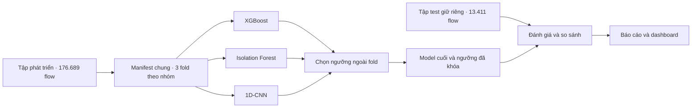

<div align="center">

# 🛡️ DoH Tunneling Detection

**Phát hiện DNS tunneling trong lưu lượng DNS-over-HTTPS mã hóa**

`XGBoost` · `Isolation Forest` · `1D-CNN` · `CIRA-CIC-DoHBrw-2020`

[🚀 Bắt đầu](#bắt-đầu) · [📂 Cấu trúc project](#cấu-trúc-project) · [📊 Dashboard và báo cáo](#dashboard-và-báo-cáo) · [📖 Hướng dẫn dữ liệu](docs/TRAINING_GUIDE.md) · [🛠️ Công việc](TODO.md)

</div>

---

## Giới thiệu đề tài

DNS-over-HTTPS (DoH) truyền các truy vấn DNS qua HTTPS, bảo vệ nội dung truy vấn trong kết nối mã hóa. DNS tunneling lợi dụng cơ chế trao đổi DNS để mang dữ liệu hoặc thông tin điều khiển; khi đi qua DoH, việc quan sát trực tiếp nội dung DNS từ lưu lượng mạng trở nên khó khăn hơn.

Đề tài nghiên cứu khả năng **phân biệt benign DoH và tunnel DoH bằng đặc trưng hành vi mạng, không giải mã payload**. Dữ liệu lấy từ CIRA-CIC-DoHBrw-2020, gồm lưu lượng browser Chrome/Firefox và các công cụ tunnel dns2tcp, dnscat2, iodine theo kịch bản nguồn.

| Nội dung           | Phạm vi thực hiện                                                                |
| ------------------- | ----------------------------------------------------------------------------------- |
| Bài toán          | Phân loại nhị phân: `0 = benign DoH`, `1 = malicious/tunnel DoH`            |
| Dữ liệu quan sát | Thống kê flow và chuỗi độ dài, hướng truyền, thời gian giữa packet      |
| Phương pháp      | Học có giám sát, phát hiện bất thường từ benign và học chuỗi bằng CNN |
| Sản phẩm          | Ba baseline, evaluator chung và dashboard so sánh kết quả                       |
| Phạm vi            | Phân tích offline trên dataset; chưa triển khai IDS thời gian thực           |

### Cơ sở lý thuyết

**Flow và packet sequence.** Flow gom các packet thuộc một luồng giao tiếp để tính các thống kê như duration, lượng byte và phân bố thời gian/kích thước. Packet sequence giữ thứ tự các gói để mô hình học biến thiên theo thời gian. Dù payload được mã hóa, độ dài, thời điểm và hướng truyền vẫn cung cấp dấu hiệu có thể dùng để phân loại.

| Mô hình                  | Nguyên lý                                                                                                        | Đầu vào trong dự án                                    | Điểm cần khảo sát                                                                               |
| -------------------------- | ------------------------------------------------------------------------------------------------------------------ | ----------------------------------------------------------- | ---------------------------------------------------------------------------------------------------- |
| **XGBoost**          | Kết hợp nhiều cây quyết định theo boosting, các cây sau cải thiện hàm mục tiêu của tổ hợp         | 29 thống kê flow; train có cả hai nhãn                 | Hiệu quả phân loại trên đặc trưng dạng bảng                                                |
| **Isolation Forest** | Cô lập mẫu bằng các phép chia ngẫu nhiên; mẫu bất thường thường có đường đi cô lập ngắn hơn | 29 thống kê đã scale; chỉ fit benign train             | Khả năng phát hiện tunnel từ mô hình học lưu lượng bình thường và mức cảnh báo sai |
| **1D-CNN**           | Tích chập một chiều học các mẫu cục bộ trên chuỗi packet                                                | Tối đa 32 packet, 3 kênh length/direction/IAT, kèm mask | Khả năng khai thác cấu trúc và thứ tự packet                                                 |

Isolation Forest fit cây trên các flow benign và dùng nhãn ngoài fold để chọn ngưỡng phát hiện. 1D-CNN dùng mask trong các lớp tích chập và khi gộp đặc trưng để bỏ qua padding.

### Câu hỏi thực nghiệm và điểm nhấn

- Ba phương pháp phát hiện được bao nhiêu tunnel và tạo ra bao nhiêu cảnh báo sai trên cùng tập flow đánh giá?
- Hiệu quả khác nhau thế nào giữa dns2tcp, dnscat2 và iodine; benign Chrome/Firefox có mức false positive ra sao?
- Mức phát hiện đạt được có tương xứng với thời gian inference và kích thước model không?

Điểm nhấn là **phát hiện từ hành vi của traffic mã hóa**, **so sánh ba cách tiếp cận trên cùng test IDs** và **đánh giá đồng thời Recall, FPR và chi phí tính toán**. XGBoost/IF dùng thống kê toàn flow, CNN dùng prefix 32 packet: kết quả so sánh cả phương pháp lẫn biểu diễn đầu vào, chưa tách riêng ảnh hưởng kiến trúc.

---

## Bắt đầu

Cần **Python 3.11 trở lên** và Git. Các lệnh dưới đây dùng shell Linux hoặc macOS và chạy từ thư mục gốc của repo.

```bash
git clone https://github.com/doandangkhoa/DoH-tunneling-detection.git
cd DoH-tunneling-detection
python3 -m venv .venv
source .venv/bin/activate
python -m pip install -r requirements.txt
```

Nhận `common.tar.gz` từ kho chia sẻ của nhóm rồi giải nén vào thư mục gốc. Trên máy đã tạo gói, file nằm ở `data/exports/common.tar.gz`.

```bash
tar -xzf common.tar.gz
```

Giữ nguyên các đường dẫn khi bàn giao dữ liệu. Git bỏ qua các file dữ liệu, checkpoint và dự đoán lớn.

| Dùng cho               | File cần có                                                                                       |
| ----------------------- | --------------------------------------------------------------------------------------------------- |
| Cả ba mô hình        | `splits/common_folds.parquet`                                                                     |
| XGBoost                 | `data/processed/xgboost/common/{development,test}.npz` và `data/interim/flow_features.parquet` |
| Isolation Forest        | `data/processed/isolation_forest/common/{development,test}.npz`, có mảng `X_raw`              |
| 1D-CNN                  | `data/processed/cnn1d/{development,test}.npz`, có `X_raw` và `mask`                         |
| Đánh giá theo nguồn | `data/processed/cnn1d/test_metadata.parquet`                                                      |

Nếu gói CNN1D còn chứa `train.npz` và `val.npz` riêng, tạo file phát triển một lần sau khi giải nén. Lệnh này cần manifest 3 fold ở đúng đường dẫn trong bảng.

```bash
python scripts/prepare_cnn1d_development.py
```

## Chạy mô hình

Chạy `train` rồi `predict` cho mô hình cần đánh giá. Cả ba lệnh `predict` đều in chỉ số test ngay trong terminal. Chạy cả ba cặp lệnh để tạo đầy đủ dữ liệu cho dashboard và báo cáo chung.

```bash
# XGBoost
python -m src.xgboost.train && python -m src.xgboost.predict

# Isolation Forest
python -m src.isolation_forest.train && python -m src.isolation_forest.predict

# 1D-CNN
python -m src.cnn1d.train && python -m src.cnn1d.predict
```

CNN1D chạy 30 epoch cho từng lượt trong ba fold và 30 epoch cho mô hình cuối. Khi chạy trên CPU, có thể đặt `OMP_NUM_THREADS=2` và `MKL_NUM_THREADS=2` để tái hiện cấu hình giới hạn luồng đã dùng trong lần chạy báo cáo. Mỗi lệnh `predict` ghi `outputs/<model>/predictions.parquet` với ID, nhãn thật, điểm dự đoán, ngưỡng và nhãn dự đoán. Checkpoint và cấu hình của lần chạy nằm trong `models/<model>/` và `experiments/<model>/`.

## Quy trình đánh giá



Bộ `common` có **190.100 flow**. Tập phát triển gồm **176.689 flow** từ train và validation cũ. Tập test giữ riêng **13.411 flow**, gồm 6.792 benign và 6.619 tunnel.

1. Dùng cùng manifest để chia tập phát triển thành 3 fold theo nhóm thu thập.
2. Mỗi lượt fit tiền xử lý và mô hình trên phần huấn luyện, rồi chấm điểm fold giữ riêng. Gộp dự đoán ngoài fold để chọn ngưỡng.
3. Xét các ngưỡng đạt Recall tunnel ngoài fold ít nhất **99%** và chọn ngưỡng có FPR thấp nhất trên trình duyệt bị báo nhầm nhiều hơn.
4. Fit mô hình cuối trên tập phát triển theo quy tắc của từng mô hình, rồi áp dụng ngưỡng đã khóa lên test. Recall thực tế trên test có thể khác 99%.

| Mô hình                                        | Đầu vào và cách học                                                                                                                                   |
| ------------------------------------------------ | ----------------------------------------------------------------------------------------------------------------------------------------------------------- |
| [XGBoost](configs/xgboost.yaml)                   | 29 thống kê toàn flow, học có giám sát từ cả hai lớp.                                                                                             |
| [Isolation Forest](configs/isolation_forest.yaml) | Cùng 29 thống kê flow. Fit cây và tiền xử lý chỉ trên benign, gồm 6.818 flow cho mô hình cuối. Điểm cao hơn biểu thị bất thường hơn. |
| [1D-CNN](configs/cnn1d.yaml)                      | Tối đa 32 packet đầu, với độ dài, hướng truyền, thời gian giữa các gói và mask để xử lý padding.                                        |

## Dashboard và báo cáo

Chạy **DoH Model Lab** rồi mở [http://127.0.0.1:8511/](http://127.0.0.1:8511/).

```bash
python -m streamlit run dashboard/app.py --server.address 127.0.0.1 --server.port 8511 --theme.base light
```

Dashboard đọc dự đoán có sẵn trong `outputs/`. Chọn mô hình để xem chỉ số test, ma trận nhầm lẫn, đường Precision–Recall và kết quả theo trình duyệt hoặc công cụ tunnel.

Tạo lại bảng và biểu đồ sau khi có đủ dự đoán và báo cáo lần chạy của cả ba mô hình.

```bash
python -m src.evaluation.evaluate
```

Xem [hướng dẫn đọc báo cáo](reports/README.md), [bảng tổng hợp](reports/tables/metrics.csv), [bảng theo nguồn](reports/tables/source_metrics.csv) và [thư mục biểu đồ](reports/figures). Trình đánh giá kiểm tra ID và nhãn test trước khi tổng hợp.

## Kết quả trên tập test chung

| Mô hình        |     F1 | Recall tunnel | FPR benign |     AP |
| ---------------- | -----: | ------------: | ---------: | -----: |
| XGBoost          | 97,30% |        96,43% |      1,74% | 99,47% |
| Isolation Forest | 76,63% |        99,49% |     58,63% | 69,03% |
| 1D-CNN           | 94,78% |        96,90% |      7,39% | 89,85% |

XGBoost có F1 cao nhất và FPR thấp nhất trong lần chạy này. Isolation Forest phát hiện nhiều tunnel nhất và cũng tạo nhiều cảnh báo sai nhất. AP là Average Precision. FPR là tỷ lệ flow benign bị gắn nhãn tunnel.

Kết quả phản ánh cả phương pháp học và biểu diễn đầu vào. Số nhóm thu thập benign độc lập còn hạn chế, đặc biệt với Chrome. Thời gian inference đã ghi dùng batch và cách warm-up khác nhau, nên chưa đủ để kết luận về tốc độ trong cùng điều kiện.

## Cấu trúc project

```text
DoH-tunneling-detection/
├── .github/workflows/            # Kiểm tra cấu trúc và cú pháp trên GitHub
├── configs/                      # Cấu hình dữ liệu và ba mô hình
├── dashboard/
│   └── app.py                    # DoH Model Lab chạy bằng Streamlit
├── data/
│   ├── raw/                      # CSV và PCAP nguồn
│   ├── interim/                  # Đặc trưng flow và dữ liệu trung gian
│   │   └── flow_features.parquet # Đặc trưng trước tiền xử lý cho XGBoost predict
│   ├── processed/
│   │   ├── xgboost/common/        # Tập phát triển và test của XGBoost
│   │   ├── isolation_forest/common/ # Tập phát triển và test của Isolation Forest
│   │   └── cnn1d/                # Chuỗi packet, mask và metadata test
│   └── exports/                  # Gói bàn giao common.tar.gz
├── docs/                         # Hướng dẫn dữ liệu và quy trình Git
├── experiments/                  # Ngưỡng đã khóa, log và số liệu lần chạy
├── models/                       # Checkpoint và tham số tiền xử lý
├── outputs/
│   ├── xgboost/                  # predictions.parquet
│   ├── isolation_forest/         # predictions.parquet
│   └── cnn1d/                    # predictions.parquet
├── reports/
│   ├── README.md                 # Cách đọc và tạo lại báo cáo
│   ├── figures/                  # Ma trận nhầm lẫn, đường PR và biểu đồ theo nguồn
│   └── tables/                   # Chỉ số tổng hợp, runtime và mẫu dự đoán sai
├── scripts/                      # Chuẩn bị dữ liệu fold, audit và đóng gói
├── splits/
│   └── common_folds.parquet      # Manifest 3 fold dùng chung
├── src/
│   ├── data/                    # Chuẩn bị dữ liệu từ CSV và PCAP
│   ├── xgboost/                 # Train và predict XGBoost
│   ├── isolation_forest/        # Train và predict Isolation Forest
│   ├── cnn1d/                   # Loader, mô hình, train và predict 1D-CNN
│   └── evaluation/
│       ├── evaluate.py          # Đọc và đối chiếu dự đoán test
│       ├── metrics.py           # Tính chỉ số phân loại
│       └── plots.py             # Xuất hình cho báo cáo
├── tests/                        # Kiểm thử dữ liệu và mô hình
├── requirements.txt
├── TODO.md
└── README.md
```

## Kiểm tra

```bash
python scripts/verify_repository.py
python -m pytest -q
```

Xem thêm [hướng dẫn dữ liệu](docs/TRAINING_GUIDE.md), [quy trình Git](docs/git_workflow.md) và [phân công nhóm](TODO.md).
